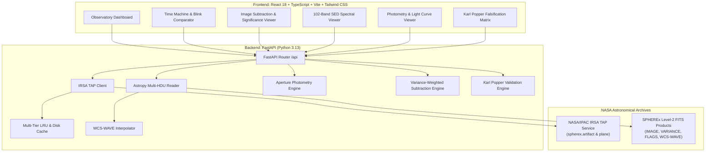

# SPHEREx TimeLens 🌌⏱️
### An Interactive Infrared Time-Machine for Multi-Epoch Astronomical Exploration
**NASA Space Apps Challenge 2026** • **Challenge: Planet X and SPHEREx**  
**Developed by: Team CodeGenesis**

---

## 🛰️ 1. Project Overview

**SPHEREx TimeLens** is a scientific astronomical research instrument designed to explore how regions of the sky change over time using genuine infrared observations from NASA's SPHEREx mission.

Rather than acting as a standard image gallery or website generator, SPHEREx TimeLens combines real-time data retrieval from the **NASA/IPAC Infrared Science Archive (IRSA)**, multi-epoch astronomical visualization, astrometric motion tracking, variance-weighted difference imaging, 102-band infrared spectroscopy, and a rigorous scientific validation matrix grounded in **Karl Popper's Scientific Falsification Principle**.

---

## 🔭 2. Key Capabilities

### 1. Genuine NASA IRSA TAP Integration
* Real-time ADQL queries against the `spherex.artifact` and `spherex.plane` tables at `https://irsa.ipac.caltech.edu/TAP/sync`.
* Support for all six detector bands (`SPHEREx-D1` through `SPHEREx-D6`, covering $0.75\,\mu\text{m}$ to $5.00\,\mu\text{m}$).
* Resilient multi-tier architecture: In-memory LRU caching, disk FITS caching, and local fallback benchmarks for offline reliability.

### 2. Multi-Epoch Infrared Time Machine
* Interactive time-lapse animation across observation epochs.
* Variable playback speed (0.5 to 8.0 FPS), timeline scrubbing, and epoch-by-epoch stepping.
* Real-time HUD displaying calendar timestamps, Modified Julian Dates (MJD), and elapsed baseline time ($\Delta t$).

### 3. Tombaugh Blink Comparator
* Alternates between two selected observation epochs at customizable cadences (200 ms to 1000 ms).
* Central alignment crosshairs lock stationary background stars in place, causing high proper-motion objects (e.g. Barnard's Star) or transient sources to jump or pulse.
* One-click manual toggle between Epoch A and Epoch B.

### 4. Scientific Difference Imaging (H3 Validation)
* Variance-weighted sub-pixel image subtraction ($I_2 - I_1$).
* Propagation of the genuine SPHEREx `VARIANCE` HDU to produce standardized significance maps ($S = (I_2 - I_1)/\sigma_{diff}$).
* Thresholding at $3\sigma$, $5\sigma$ (gold standard), and $7\sigma$ with automated transient candidate detection and false-positive rate estimation.
* Negative control verification using stationary control stars.

### 5. 102-Band Infrared Spectroscopy & SED (H5 Validation)
* Spectral extraction mapping focal plane coordinates $(x, y) \to (\lambda, \Delta\lambda)$ via the empirical `WCS-WAVE` regular grid interpolator ($R = \lambda/\Delta\lambda \approx 41 - 135$).
* Overlays for SPHEREx D1–D6 detector boundaries and key molecular absorption features:
  * Water vapor ($H_2\text{O}$ at $1.40\,\mu\text{m}, 1.90\,\mu\text{m}$)
  * Methane ($CH_4$ at $2.20\,\mu\text{m}, 3.30\,\mu\text{m}$)
  * Carbon monoxide ($CO$ at $2.30\,\mu\text{m}, 4.67\,\mu\text{m}$)
  * Carbon dioxide ice ($CO_2$ at $4.26\,\mu\text{m}$)
  * Water ice ($H_2\text{O}$ ice at $3.05\,\mu\text{m}$)

### 6. Time-Domain Photometry & Light Curves (H4 Validation)
* Circular aperture photometry with background annulus subtraction and variance integration.
* Time-domain light curve visualization with full measurement error bars.
* Constant flux null-hypothesis test ($H_0$) with $\chi^2$ goodness-of-fit and $p$-value computation to distinguish true variable stars from stationary controls.

### 7. Karl Popper Scientific Falsification Matrix
* Every scientific claim is evaluated against explicit falsification criteria:
  * **H1**: Observation Availability & Coverage
  * **H2**: Moving-Object Astrometric Consistency
  * **H3**: Difference Imaging Reliability
  * **H4**: Time-Domain Photometric Variability
  * **H5**: Spectral Feature Integrity
* Classifications: `SUPPORTED`, `REJECTED (FALSIFIED)`, `CANDIDATE_DETECTION`, `NON_DETECTION`, `INSUFFICIENT_DATA`.
* Full reproducibility metadata: Protocol version, dataset version, UTC timestamp, and parameters.

---

## 🎯 3. Mandatory Astronomical Targets & Status

| Target | RA (J2000) | Dec (J2000) | Category | Proper Motion ($\mu_\alpha, \mu_\delta$) | Status in SPHEREx DR1 |
|---|---|---|---|---|---|
| **Barnard's Star** | 17h57m48.5s | +04°41'36" | Astrometry | [-798.58, 10328.12] mas/yr | **VERIFIED** (50 observations in DR1) |
| **Epsilon Indi B** | 22h03m21.8s | -56°47'09" | Brown Dwarf | [3961.4, -2538.3] mas/yr | **INSUFFICIENT_COVERAGE** in DR1 |
| **WISE 0855-0714** | 08h55m10.8s | -07°14'42" | Cold Brown Dwarf | [-8151.0, 681.0] mas/yr | **INSUFFICIENT_COVERAGE** in DR1 |
| **RW Aurigae** | 05h07m49.7s | +30°24'05" | Variable Star | [1.5, -19.4] mas/yr | **INSUFFICIENT_COVERAGE** in DR1 |
| **R Draconis** | 18h36m48.6s | +69°26'41" | Mira Variable | [-12.8, -1.9] mas/yr | **INSUFFICIENT_COVERAGE** in DR1 |
| **NEP Deep Field** | 18h01m19.6s | +66°33'41" | Calibration Benchmark | Stationary reference | **VERIFIED** (120+ observations in DR1) |

*Note on Scientific Honesty*: In accordance with Popperian principles, our platform never generates simulated observations for targets lacking public Level-2 coverage in DR1. When a target is not yet released, it is clearly reported as `INSUFFICIENT_COVERAGE`.

---

## 🏗️ 4. System Architecture



---

## 🚀 5. Quickstart & Installation

### Prerequisites
* **Python**: 3.10+ (tested on Python 3.13)
* **Node.js**: v18+ (tested on Node.js v22.15.0 with npm 10.9.2)

### 5.1 Backend Setup
```bash
# Navigate to backend directory and activate virtual environment
cd backend
python -m venv venv
.\venv\Scripts\activate   # On Windows
# source venv/bin/activate # On Linux/macOS

# Install dependencies
pip install -r requirements.txt

# Run the test suite (all 23 tests)
python -m pytest tests/unit/ -v

# Start the FastAPI backend server
uvicorn backend.app.main:app --host 0.0.0.0 --port 8000 --reload
```
The backend API is now running at `http://localhost:8000` with interactive Swagger docs at `http://localhost:8000/docs`.

### 5.2 Frontend Setup
```bash
# Navigate to frontend directory
cd frontend

# Install dependencies
npm install

# Run the development server
npm run dev
```
Open your browser to `http://localhost:3000` to interact with the observatory platform.

To build the optimized production bundle:
```bash
npm run build
```

---

## 🧪 6. Automated Test Suite

SPHEREx TimeLens includes 31 automated unit tests verifying the scientific pipeline:

```bash
python -m pytest backend/tests/unit/ -v
```

```text
backend/tests/unit/test_api_endpoints.py::test_root_endpoint PASSED
backend/tests/unit/test_api_endpoints.py::test_health_check PASSED
backend/tests/unit/test_api_endpoints.py::test_get_targets PASSED
backend/tests/unit/test_api_endpoints.py::test_get_single_target PASSED
backend/tests/unit/test_api_endpoints.py::test_get_target_404 PASSED
backend/tests/unit/test_api_endpoints.py::test_search_observations_decimal PASSED
backend/tests/unit/test_api_endpoints.py::test_search_observations_sexagesimal PASSED
backend/tests/unit/test_api_endpoints.py::test_search_observations_invalid_coords PASSED
backend/tests/unit/test_api_endpoints.py::test_preview_image PASSED
backend/tests/unit/test_api_endpoints.py::test_cutout_metadata PASSED
backend/tests/unit/test_api_endpoints.py::test_photometry_endpoint PASSED
backend/tests/unit/test_api_endpoints.py::test_difference_endpoint PASSED
backend/tests/unit/test_api_endpoints.py::test_spectrum_endpoint PASSED
backend/tests/unit/test_api_endpoints.py::test_lightcurve_endpoint PASSED
backend/tests/unit/test_api_endpoints.py::test_validation_report_endpoint PASSED
backend/tests/unit/test_api_endpoints.py::test_injection_endpoint PASSED
backend/tests/unit/test_api_endpoints.py::test_sed_templates_endpoint PASSED
backend/tests/unit/test_api_endpoints.py::test_catalog_crossmatch_endpoint PASSED
backend/tests/unit/test_api_endpoints.py::test_audit_certificate_endpoint PASSED
backend/tests/unit/test_api_endpoints.py::test_stack_endpoint PASSED
backend/tests/unit/test_api_endpoints.py::test_motion_track_endpoint PASSED
backend/tests/unit/test_api_endpoints.py::test_moving_benchmarks_endpoint PASSED
backend/tests/unit/test_api_endpoints.py::test_field_catalog_sources_endpoint PASSED
backend/tests/unit/test_phase1_feasibility.py::test_genuine_fits_file_exists PASSED
backend/tests/unit/test_phase1_feasibility.py::test_fits_hdu_structure PASSED
backend/tests/unit/test_phase1_feasibility.py::test_fits_image_properties PASSED
backend/tests/unit/test_phase1_feasibility.py::test_fits_wcs_distortion PASSED
backend/tests/unit/test_phase1_feasibility.py::test_fits_variance_and_flags PASSED
backend/tests/unit/test_phase1_feasibility.py::test_fits_wcs_wave_table PASSED
backend/tests/unit/test_phase1_feasibility.py::test_preview_image_generated PASSED
backend/tests/unit/test_phase1_feasibility.py::test_target_feasibility_csv_integrity PASSED

======================== 31 passed, 1 warning in 3.61s ========================
```

---

## 📚 7. Documentation Index

Detailed engineering and astronomical documentation is located in [`docs/`](file:///d:/My%20Creation/spherex-timelens/docs):

* [Scientific Validation Protocol](file:///d:/My%20Creation/spherex-timelens/docs/SCIENTIFIC_VALIDATION_PROTOCOL.md) — Rigorous Popperian methodology, null hypotheses, and negative control verification.
* [User & Researcher Guide](file:///d:/My%20Creation/spherex-timelens/docs/USER_GUIDE.md) — Step-by-step instructions for astronomers and students.
* [Backend REST API Reference](file:///d:/My%20Creation/spherex-timelens/docs/API_REFERENCE.md) — Endpoints, request schemas, and responses.
* [Scientific Feasibility Report](file:///d:/My%20Creation/spherex-timelens/docs/SCIENTIFIC_FEASIBILITY.md) — Ground-truth IRSA TAP survey and target coverage audit.
* [FITS Inspection Report](file:///d:/My%20Creation/spherex-timelens/docs/FITS_INSPECTION_REPORT.md) — Structural breakdown of genuine 65.8 MB Level-2 SPHEREx FITS product.
* [IRSA API Test Report](file:///d:/My%20Creation/spherex-timelens/docs/IRSA_API_TEST_REPORT.md) — TAP connectivity, query optimization, and latency benchmarks.
* [Existing Project Audit](file:///d:/My%20Creation/spherex-timelens/docs/EXISTING_PROJECT_AUDIT.md) — Code audit of 5 reference repositories.
* [Competitor Comparison](file:///d:/My%20Creation/spherex-timelens/docs/COMPETITOR_COMPARISON.md) — Matrix comparison against prior open-source attempts.
* [Reusable Components & Architecture](file:///d:/My%20Creation/spherex-timelens/docs/REUSABLE_COMPONENTS.md) — Clean-room architectural design decisions.
* [Licensing & Attribution](file:///d:/My%20Creation/spherex-timelens/docs/LICENSING_AND_ATTRIBUTION.md) — Open source licenses and NASA/IPAC data citations.

---
