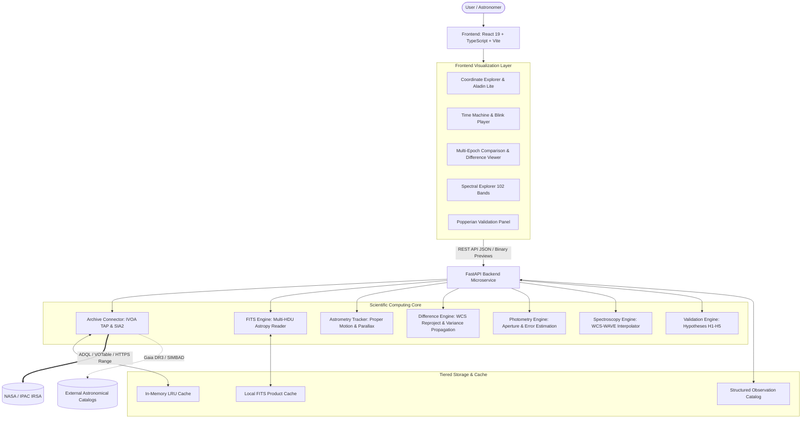

# System Architecture Specification
**Project: SPHEREx TimeLens**  
**Team: CodeGenesis**  
**Challenge: Planet X and SPHEREx — NASA Space Apps Challenge 2026**

---

## 1. Architectural Vision

**SPHEREx TimeLens** is an open-science astronomical research instrument designed to explore multi-epoch infrared sky variations using genuine data from NASA's SPHEREx mission.

The system decouples high-throughput scientific data reduction on the backend from high-framerate interactive multi-epoch visualization on the frontend, enforcing Karl Popper's falsification principle across all scientific workflows.

---

## 2. Component Specifications

### 2.1 Backend Modules (`backend/app/`)

1. **`main.py`**:
   - FastAPI application entry point, CORS configuration, centralized error handling, and route orchestration.
2. **`archive/`**:
   - `irsa_client.py`: Resilient client implementing IVOA TAP sync/async queries and SIA v2 discovery. Handles SSL/TLS renegotiation, timeout recovery, and multi-release management (`spherex_dr1`, `spherex_qr3`).
   - `downloader.py`: Resumable streaming HTTP downloader with SHA-256 integrity verification and partial HTTP Range requests.
3. **`fits/`**:
   - `reader.py`: Multi-HDU reader parsing `PRIMARY`, `IMAGE`, `FLAGS`, `VARIANCE`, `ZODI`, `EPSF`, and `WCS-WAVE`.
   - `validator.py`: Asserts WCS validity, TAN-SIP polynomial sanity, and pixel integrity (NaN/Inf accounting).
   - `preview.py`: High-performance percentile contrast stretcher (ZScale/Asinh) generating browser-friendly PNG/WebP representations while preserving raw scientific arrays.
4. **`astrometry/`**:
   - `tracker.py`: Implements two modes:
     - *Fixed Sky Mode*: Static celestial coordinates $(\alpha, \delta)_\text{ICRS}$.
     - *Moving Target Mode*: Calculates space-motion propagation accounting for proper motion $(\mu_\alpha^*, \mu_\delta)$, parallax $\varpi$, and radial velocity to target observation epoch MJD.
5. **`processing/`**:
   - `registration.py`: WCS-aware sub-pixel spatial reprojection using Astropy Reproject.
   - `difference.py`: Background matching, flux normalization, and variance propagation for difference imaging ($D = I_A - k I_B$, $\sigma_D^2 = \sigma_A^2 + k^2 \sigma_B^2$).
   - `detection.py`: Sigma-clipped candidate transient and moving object extractor with stationary control masks.
6. **`spectroscopy/`**:
   - `wave_calibrator.py`: 2D regular grid interpolator mapping pixel focal-plane coordinates $(x, y)$ to central wavelength $\lambda_0$ and bandpass $\Delta\lambda$ using the `WCS-WAVE` binary table.
7. **`validation/`**:
   - `engine.py`: Evaluates hypotheses $H_1$ to $H_5$ and generates structured provenance records and downloadable Markdown/JSON validation reports.

---

### 2.2 Frontend Modules (`frontend/src/`)

1. **`components/sky-viewer/`**:
   - Combines an interactive FITS preview canvas with Aladin Lite overlay, supporting pan, zoom, contrast stretch, coordinate cursor readout, and external catalog toggles (Gaia DR3, AllWISE).
2. **`components/timeline/`**:
   - Interactive time-machine player with chronological scrubbing, variable playback framerates (0.5 fps to 10 fps), frame stepping, and blink comparator mode.
3. **`components/comparison/`**:
   - Side-by-side multi-epoch visualizer, interactive split wiper, registered difference map, and significance map ($S = D / \sigma_D$).
4. **`components/spectral/`**:
   - 102-band selector with wavelength coverage indicators, interactive SED plot (Plotly.js), and filter transmission curves.
5. **`components/analysis/`**:
   - Photometric aperture inspector, light curve constructor, and hypothesis falsification dashboard displaying detection status, signal-to-noise ratio, and quality flags.

---

## 3. Data Dimension Preservation Protocol

To maintain scientific fidelity, the platform enforces strict decoupling of data dimensions:
- **Spatial Dimension**: RA ($\alpha$) and Dec ($\delta$) in ICRS decimal degrees.
- **Spectral Dimension**: Continuous wavelength $\lambda$ from 0.75 $\mu\text{m}$ to 5.00 $\mu\text{m}$ across 102 nominal channels and 6 detectors (D1–D6).
- **Temporal Dimension**: Observation time MJD / UTC.
- **Instrumental Dimension**: Detector array ID (1–6), exposure ID, gain, and PSF configuration.

Under no circumstances does the application treat spectral channels as time frames or average incompatible spectral bands into pseudo-time-lapses.
